# Cache Controller Architecture Block Diagram

This document illustrates the complete microarchitecture of the 4~KB Direct-Mapped Cache Controller subsystem, detailing the interconnections between the CPU core, Cache Controller FSM, Tag Array, Data Array, and Backing Main Memory.

---

## Microarchitectural Block Diagram (Mermaid)

```mermaid
flowchart TB
    subgraph CPU["CPU Core Interface"]
        direction TB
        CPU_REQ["req (Request)"]
        CPU_WE["we (Write Enable)"]
        CPU_ADDR["addr[31:0] (Address)"]
        CPU_WDATA["wdata[31:0] (Write Data)"]
        CPU_RDATA["rdata[31:0] (Read Data)"]
        CPU_READY["ready (Handshake)"]
    end

    subgraph ADDR_DECODE["Address Decomposition"]
        direction TB
        TAG_FIELD["Tag [31:12] (20 bits)"]
        INDEX_FIELD["Index [11:4] (8 bits)"]
        WORD_FIELD["Block Offset [3:2] (2 bits)"]
        BYTE_FIELD["Byte Offset [1:0] (2 bits)"]
    end

    subgraph CONTROLLER["Cache Controller Subsystem"]
        direction TB
        FSM["Controller FSM\n(IDLE, COMPARE_TAG,\nWRITE_BACK, ALLOCATE)"]
        HIT_LOGIC["Hit / Miss Evaluation\n(hit = valid && tag_match)"]
        DIRTY_LOGIC["Dirty / Eviction Logic\n(evict_dirty = !hit && valid && dirty)"]
    end

    subgraph TAG_SUB["Tag Array Subsystem (256 Lines)"]
        direction TB
        TAG_MEM["Tag Array (256 x 22b)\nValid[21], Dirty[20], Tag[19:0]"]
        TAG_COMP["Tag Comparator (20-bit ==)"]
    end

    subgraph DATA_SUB["Data Array Subsystem (256 Lines)"]
        direction TB
        DATA_MEM["Data Array (256 x 128b)\n(16 Bytes per Line)"]
        WORD_MUX["Read Word Mux (4:1 x 32b)"]
        WORD_INSERTER["Write Word Inserter (128b)"]
    end

    subgraph MEM_IF["Backing Main Memory (Latency = 10 Cycles)"]
        direction TB
        MEM_REQ["mem_req"]
        MEM_WE["mem_we"]
        MEM_ADDR["mem_addr[31:0]"]
        MEM_WDATA["mem_wdata[127:0]"]
        MEM_RDATA["mem_rdata[127:0]"]
        MEM_READY["mem_ready"]
    end

    %% CPU Connections to Address Decode & Controller
    CPU_ADDR --> TAG_FIELD
    CPU_ADDR --> INDEX_FIELD
    CPU_ADDR --> WORD_FIELD
    CPU_ADDR --> BYTE_FIELD

    CPU_REQ --> FSM
    CPU_WE --> FSM
    FSM --> CPU_READY

    %% Tag Subsystem Connections
    INDEX_FIELD --> TAG_MEM
    TAG_FIELD --> TAG_COMP
    TAG_MEM -->|"tag_out[19:0]"| TAG_COMP
    TAG_MEM -->|"valid_out"| HIT_LOGIC
    TAG_MEM -->|"valid_out"| DIRTY_LOGIC
    HIT_LOGIC -->|"hit / miss"| DIRTY_LOGIC
    TAG_MEM -->|"dirty_out"| DIRTY_LOGIC
    TAG_COMP -->|"tag_match"| HIT_LOGIC

    FSM -->|"tag_we"| TAG_MEM
    FSM -->|"set_dirty"| TAG_MEM
    TAG_FIELD -->|"tag_in[19:0]"| TAG_MEM

    %% Data Subsystem Connections
    INDEX_FIELD --> DATA_MEM
    WORD_FIELD --> WORD_MUX
    DATA_MEM -->|"block_rdata[127:0]"| WORD_MUX
    WORD_MUX -->|"selected 32b word"| CPU_RDATA

    CPU_WDATA --> WORD_INSERTER
    WORD_FIELD --> WORD_INSERTER
    DATA_MEM -->|"old block data"| WORD_INSERTER
    WORD_INSERTER -->|"merged block data"| DATA_MEM
    FSM -->|"data_we_word"| DATA_MEM
    FSM -->|"data_we_block"| DATA_MEM

    %% Memory Subsystem Connections
    HIT_LOGIC -->|"hit"| FSM
    DIRTY_LOGIC -->|"dirty eviction"| FSM

    DATA_MEM -->|"mem_wdata[127:0]"| MEM_WDATA
    MEM_RDATA -->|"mem_rdata[127:0]"| DATA_MEM

    FSM --> MEM_REQ
    FSM --> MEM_WE
    FSM --> MEM_ADDR
    MEM_READY --> FSM
```

---

## Architectural Description & Dataflow

1. **CPU Memory Request Phase**:
   - The CPU issues `req = 1`, `we` (0 for read, 1 for write), `addr[31:0]`, and if writing, `wdata[31:0]`.
   - The controller latches the request. The decoder uses the latched `Index[11:4]` to select line entry $0 \dots 255$.

2. **Tag Compare & Hit Determination (`COMPARE_TAG`)**:
   - `tag_array.v` yields `valid_out`, `dirty_out`, and `tag_out[19:0]` for line `index`.
   - The comparator evaluates `tag_match = (tag_out == addr[31:12])`.
   - Cache hit signal is generated: $\text{hit} = \text{valid\_out} \land \text{tag\_match}$.
   - **Read Hit**: 4:1 word multiplexer selects 32-bit word using `addr[3:2]` from the 128-bit block data and returns it via `rdata`. `ready` asserts high.
   - **Write Hit**: Data inserter merges `wdata[31:0]` into the addressed word of the 128-bit cache line. The controller asserts `set_dirty` on `tag_array` to mark the line dirty without modifying tag or valid bits. `ready` asserts high.

3. **Cache Miss & Eviction Handling**:
   - If $\text{hit} = 0$, a cache miss occurs.
   - **Miss + Dirty Line (`WRITE_BACK`)**:
     - The existing line in cache is dirty ($\text{valid\_out} \land \text{dirty\_out}$).
     - The controller initiates a 128-bit block writeback to memory at `{tag_out, index, 4'b0000}`.
     - Controller asserts `mem_req = 1`, `mem_we = 1`.
     - Waits for `mem_ready` (10 cycles).
   - **Miss + Clean Line (or after writeback finishes) (`ALLOCATE`)**:
     - Controller initiates memory read at `{addr[31:12], index, 4'b0000}`.
     - Asserts `mem_req = 1`, `mem_we = 0`.
     - When `mem_ready` asserts, memory returns 128-bit block `mem_rdata`.
     - `mem_rdata` is written to `data_array`.
     - `tag_array` installs the requested tag with `valid = 1` and `dirty = 0`.
     - Returns to `COMPARE_TAG` to complete the latched read or write, then returns to `IDLE`. A replayed write updates the word and sets dirty.
