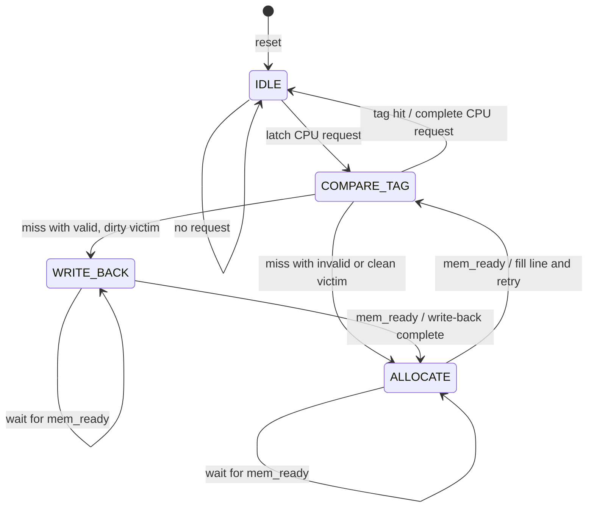

# Cache controller FSM

| State | Condition | Next state | Actions / outputs |
| --- | --- | --- | --- |
| Any | `rst` at rising edge | `IDLE` | Reset the controller and clear cache metadata. |
| `IDLE` | `req = 0` | `IDLE` | Wait for a request. |
| `IDLE` | `req = 1` | `COMPARE_TAG` | Latch `addr`, `we`, and `wdata`. |
| `COMPARE_TAG` | Valid tag match, read | `IDLE` | Return the word selected by `addr[3:2]` and assert `ready`. |
| `COMPARE_TAG` | Valid tag match, write | `IDLE` | Enable the selected word write and set dirty at the clock edge. Assert `ready`. |
| `COMPARE_TAG` | Miss, valid and dirty victim | `WRITE_BACK` | Assert `miss` and `dirty_evict`. |
| `COMPARE_TAG` | Miss, invalid or clean victim | `ALLOCATE` | Assert `miss`. |
| `WRITE_BACK` | `mem_ready = 0` | `WRITE_BACK` | Hold the block write request with the victim tag, index, and zero offset. |
| `WRITE_BACK` | `mem_ready = 1` | `ALLOCATE` | Finish the block write and advance directly to the refill. |
| `ALLOCATE` | `mem_ready = 0` | `ALLOCATE` | Hold the block read request with the requested tag, index, and zero offset. |
| `ALLOCATE` | `mem_ready = 1` | `COMPARE_TAG` | Install the returned block and requested tag. Set valid, clear dirty, and retry the latched operation. |

The FSM is Mealy. In `COMPARE_TAG`, `ready` depends on the tag comparison.
In `ALLOCATE`, the array fill enables depend on `mem_ready`. The memory request
direction is decoded from state. The memory model ignores requests on its
completion edge, then accepts the next request in its idle state.

Drive `req` with the request operands before a rising edge in `IDLE`. Sample
`ready` and read data at a rising edge, and release the completed request before
the next rising edge. State encodings are `IDLE=0`, `COMPARE_TAG=1`,
`WRITE_BACK=2`, `ALLOCATE=3`. The `hit`, `miss`, and `dirty_evict` debug
signals describe the initial comparison. A refill retry completes with `ready`
and produces no second hit/miss event.

### Corner-Case FSM Behavior and Timing Specifications

1. **Mid-Transaction Reset Abort and Recovery**:
   Synchronous active-high `rst` has absolute priority across all states. If asserted during `WRITE_BACK` or `ALLOCATE`, the FSM aborts the ongoing handshake and returns immediately to `IDLE` on the next rising clock edge. Metadata registers in the Tag Array are simultaneously cleared, while the backing memory completes or terminates its internal counter. Subsequent transactions initiate cleanly from `IDLE` with cold misses.

2. **Continuous Streaming (`req` Held High Through `ready`)**:
   Because `ready` is a Mealy output asserted combinationally in `COMPARE_TAG` upon tag match, the CPU core may maintain `req = 1` across clock edges with updated address/data. On the rising clock edge where `ready` is sampled, the controller registers the completed access and transitions to `IDLE`, immediately latching the next streaming request to enter `COMPARE_TAG` on the subsequent cycle without bus deadlocks.

3. **Back-to-Back Hit Throughput**:
   Back-to-back requests targeting distinct cache indices or identical lines execute in consecutive 2-cycle slots (`IDLE` latch $\rightarrow$ `COMPARE_TAG` hit/ready) with zero idle bubble cycles, preserving peak processor bus bandwidth.

4. **Two-Phase Dirty Eviction Handshake**:
   When a miss occurs on a valid, dirty line, the controller latches the victim's reconstructed block address (`{tag_out, index, 4'b0000}`) and transitions to `WRITE_BACK`. Upon `mem_ready = 1`, the controller transitions directly to `ALLOCATE` without returning to `IDLE`. The new block is refilled using the requested address (`{req_addr[31:4], 4'b0000}`), and on completion advances to `COMPARE_TAG` with `refilled = 1` to complete the CPU transfer.
